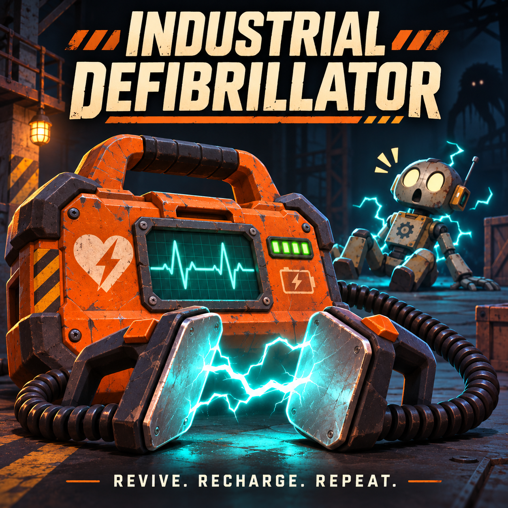

# Industrial Defibrillator for R.E.P.O.



*Promotional illustration; in-game visuals use the procedural model described below.*

**0.1.3 is an experimental test candidate, not a verified stable release.**
The plugin compiles against the Managed references supplied for R.E.P.O. 0.5.1.
Automated core and API metadata checks pass. The game has not been run in this environment.

## Requirements

- R.E.P.O. **0.5.1**, Steam.
- **BepInEx-BepInExPack-5.4.2305**.
- **Zehs-REPOLib-4.3.0**.
- Every player, including the host, must install the same mod and dependency versions.

## Install the local test build

1. Download `releases/Industrial_Defibrillator-0.1.3.zip` from this repository.
2. Create a separate Thunderstore Mod Manager profile and install the two dependencies above.
3. Use **Settings > Import local mod** if available. Alternatively, open the profile folder and extract the ZIP's `BepInEx` directory into it.
4. Remove/disable the previous mod installation before installing this update. Check that `Defibrillator.dll` and `Defibrillator.Core.dll` are together in `BepInEx/plugins/IndustrialDefibrillator/`.
5. Launch through Thunderstore on every machine. Check `BepInEx/LogOutput.log` for the plugin load and item registration messages.
6. Use a new test save and follow [the multiplayer checklist](docs/TESTING.md).

This ZIP has **not** been published to Thunderstore. No game, BepInEx or REPOLib DLLs are bundled.

## Default behavior

| Setting | Initial behavior |
| --- | --- |
| Shop | One reserved slot per normal shop population; price **2k** |
| Size and mass | Fixed compact model, approximately **35 cm wide**, nominal **3 kg** Unity mass; six fitted compound colliders |
| Use | Physically grab the device, aim at a dead player's **head**, hold **Interact** |
| Timing and range | **3 seconds**, within **2 meters** from the operator's camera to the head |
| Cancellation | Release, drop the device, move out of range, lose aim or line of sight, take damage, or leave the active round |
| Cancelled attempt | No battery consumed; a new attempt starts at zero |
| Revival | Native revival with **1 HP** |
| Battery | **50%** per successful revival; **two** uses per full charge |
| Charging | Native `ItemBattery` charging and persistence |
| Networking | Host checks identity, ownership, target, range, timing, damage and battery |
| Revival aftereffects | 50/50 high (1.8x) or low (0.55x) voice for up to 180 seconds; electrical shock every 30 seconds, strong camera jolt and 25% native tumble chance |
| Assets | Original industrial model and synthesized sounds generated at runtime |

The v0.1.0 registration failure (`Sequence contains no matching element`) is addressed by component-based donor discovery and deferred battery-display initialization. See the troubleshooting guide for new discovery messages. Retesting in the actual game is still required.

A vanilla tracker provides the runtime physics/inventory/battery shell. Its tracker behavior and donor collision geometry are removed; root scale is normalized and its visible model is replaced by original casing, paddles, cables and charge indicators. No Unity editor or AssetBundle is required.
Use from an equipped inventory slot is not implemented: physically hold the device.
If a donor has no embedded battery display, a private non-rendering copy of a native display supplies battery bookkeeping; the shared HUD is not modified. The native battery overlay retains six bars; the casing has four 25% indicators, so each default revival consumes two indicators.
The purchase limit is one new unit **per shop**, not one across the entire run.

The voice effect ends at 180 seconds, death or level end, whichever comes first. Electrical aftershocks continue for the rest of the level until death, even after the voice has returned to normal. The first shock occurs 30 seconds after revival. Each shock shows the existing blue electrical arcs, increases native shake to strength 7 for 1.2 seconds, and briefly turns only the affected player's horizontal aim by 180 degrees in a random left/right direction. The host rolls a 25% chance to enter the native Q/tumble posture, visible to everyone. Players recover using normal game controls; already-tumbling players are not toggled upright. No direct HP damage or additional launch impulse is applied; normal native tumble interactions and environmental damage still apply. Native shake follows the game's shake settings; the separate turn can be disabled with `YawDegrees=0`.

## Configuration

After first launch, edit `BepInEx/config/ciriolopipado.defibrillator.cfg` with the game closed, then restart.
The host's configuration controls validation and price; clients receive progress and outcomes.

```ini
[Revival]
HoldSeconds = 3
RangeMeters = 2
Health = 1

[Battery]
CostPercent = 50

[Shop]
Price = 2

[VoiceDebuff]
Seconds = 180
HighPitch = 1.8
LowPitch = 0.55

[Aftershock]
IntervalSeconds = 30
CameraShakeStrength = 7
CameraShakeSeconds = 1.2
YawDegrees = 180
TumbleChance = 0.25
```

On first upgrade to 0.1.2, legacy defaults `Price=0` and `CostPercent=25` migrate to `2` and `50`. Other custom values remain unchanged. The internal balance revision prevents repeated migrations; after migration, manual settings are respected. Keep your existing configuration file to retain voice and aftershock preferences.

On first upgrade to 0.1.3, legacy shake defaults `3.5` / `0.8` migrate once to `7` / `1.2`; other custom shake values remain unchanged. `TumbleChance=0` disables folding and `1` makes it happen on every eligible shock. All players must update together: the impact event uses protocol version 2.

Price uses displayed shop currency units (`2` means **2k**, not `2000`). Invalid values disable the plugin with an error log.

## Evidence and limitations

- Passed: Release compilation without warnings/errors, 61 core behavior tests and 32 game API metadata checks.
- Unrun: in-game startup, shop purchase, visuals, actual charging/persistence, voice playback, aftershock presentation, network execution, late joining, host migration and compatibility with other mods.
- Automated core tests simulate the game adapter; they do not establish multiplayer stability.
- Hold messages are sent every 0.15 seconds. A gap above 0.75 seconds resets progress; high latency can interrupt use. Aftereffect snapshots are requested every three seconds to recover late joins without restarting the voice timer.
- An active recoverable death head is required.
- The new compact model, compound collision, shelf/floor alignment, inventory restoration and weight feel still require in-game inspection. Physical dimensions and mass are fixed in this version, so all clients use the same geometry.
- If a shop exposes no item volume, guaranteed placement cannot proceed and is logged.

See [development](docs/DEVELOPMENT.md), [testing](docs/TESTING.md), [troubleshooting](docs/TROUBLESHOOTING.md), [profile inventory](docs/MOD_PROFILE.md) and [changelog](CHANGELOG.md).

## Conventions

Documentation, comments, changelog entries and commits use English. Progress is committed and pushed in coherent increments.
Never commit game binaries, credentials, user archives or third-party assets without redistribution permission.
